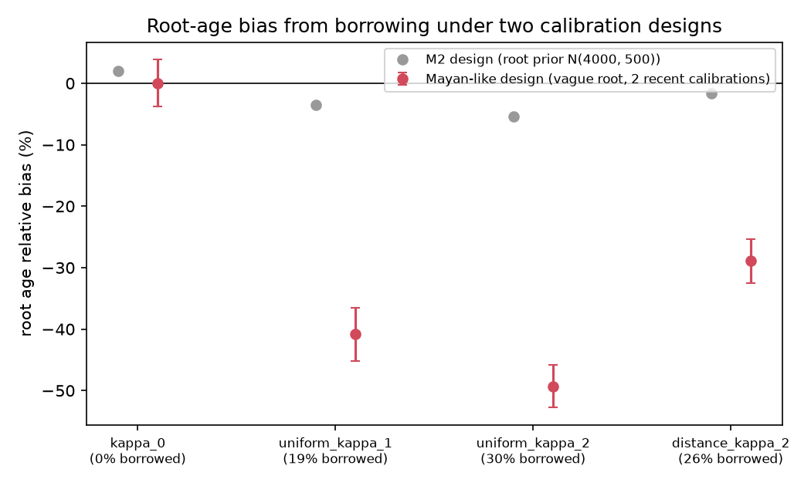
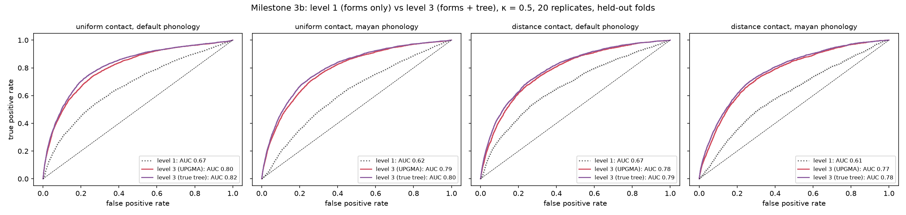
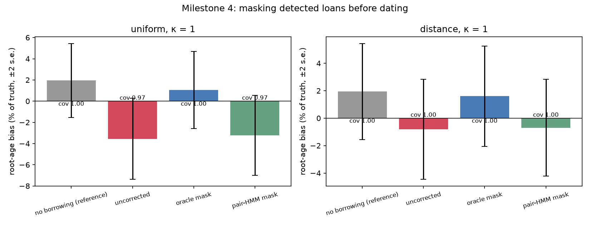
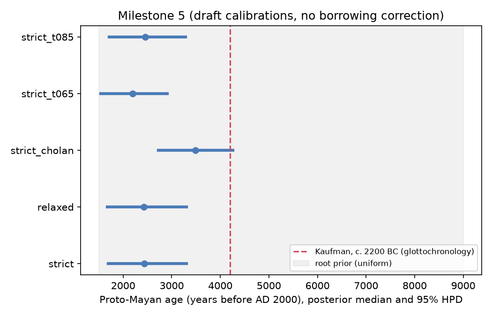

# Borrowing-aware Bayesian dating of language families

Quantifying and correcting the effect of lexical borrowing on Bayesian
divergence-time estimates, with a simulation benchmark and a Mayan case study.
The full project design is kept privately.

## Status

| Milestone | State |
|---|---|
| 0. Environment, CLDF pipeline, Mayan data, BEAST2 | done |
| 1. Simulator (no borrowing) + BEAST2 calibration | **strict clock: done** (100 replicates, below). Relaxed clock: `babelfix` written and passes the likelihood debug check; coverage study not yet run (`make m1-relaxed`) |
| 2. Bias curve vs borrowing rate, two contact models | **done** (below), plus 2b: under a realistic calibration design (vague root, recent calibrations) the root bias is 30–50% |
| 3. Phoneme strings + pair HMM, ROC | **done** (below); 3b/3c: level-3 detector (forms + tree) raises AUC from 0.61–0.67 to 0.77–0.80 with correct cognates; needs 100–200 concepts with automated cognates |
| 4. Latent-donor correction | **done** (below): masking the true loans removes the bias; masking detector flags barely helps. Latent-donor (level 2) model does not beat level 1 |
| 5. Mayan application | **runs done** (below), but the root age is implausibly young and the draft calibrations in `infer/beast/m5_mayan_prior.json` are **awaiting review**. Do not quote these dates |

## Results so far

### Milestone 1: strict clock is well calibrated

`make m1-strict`: 100 replicates with trees, root ages and loss rates drawn
from `infer/beast/m1_strict_prior.json` (10 languages, 200 concepts), each
fitted with the same prior in BEAST2.

| Parameter | 95% HPD coverage (±2 s.e.) | min ESS | rank-uniformity KS p |
|---|---|---|---|
| root age | 0.94 ± 0.05 | 1313 | 0.19 |
| tree length | 0.91 ± 0.06 | 1311 | 0.20 |
| loss rate μ | 0.90 ± 0.06 | 1362 | 0.16 (χ² p = 0.03, not significant after correcting for 3 tests) |

BEAST2's `-sampleFromPrior` marginals match the simulator's (KS p 0.25–0.65).
Note that the root-age HPD is 94% as wide as its N(4000, 500) calibration
prior: with the rate unknown, the data constrain relative ages, loss rate and
tree length much more than the absolute root. The milestone 2 summary
therefore also reports bias in μ and tree length.


### Milestone 2: bias from unmodelled borrowing

`make m2`: 30 replicates per cell, with truth drawn from the milestone 1
strict prior. Data are simulated with replacement borrowing at rate κ·μ
(κ = 0.25–2) under uniform or distance-weighted contact (e-folding at 1000 y
of patristic distance). Every fit uses the no-borrowing SDollo model.
Replicate *i* shares its tree and parameters across cells, so the **paired
Δ** (shift against the same replicate's κ = 0 fit) is the precise measure.

| Contact | Borrowed entries | Root age, paired Δ (± s.e.) | Root 95% HPD coverage | Loss rate μ bias | Tree length bias |
|---|---|---|---|---|---|
| — | 0% | 0 | 1.00 | −1% | +2% |
| uniform | 6% | −2.4% ± 0.5 | 1.00 | −11% | +11% |
| uniform | 11% | −3.6% ± 0.6 | 1.00 | −14% | +16% |
| uniform | 19% | −5.5% ± 0.7 | 0.97 | −17% | +23% |
| uniform | 30% | −7.4% ± 0.8 | 0.93 | −20% | +30% |
| distance | 6% | −1.1% ± 0.4 | 1.00 | −9% | +5% |
| distance | 10% | −1.7% ± 0.4 | 1.00 | −12% | +7% |
| distance | 17% | −2.8% ± 0.4 | 1.00 | −17% | +9% |
| distance | 26% | −3.6% ± 0.5 | 1.00 | −22% | +12% |

* **Direction.** Unmodelled borrowing makes the root *younger* and the loss
  rate *lower*, and both effects grow steadily with the borrowing rate.
  Tree length goes *up* while the root goes down, so internal nodes move
  towards the root: the tree looks more star-like.
* **Contact model.** Borrowing between near neighbours does about half the
  damage to the root and tree length. The prediction that close and distant
  borrowing bias dates in *opposite* directions is not borne out at these
  settings: both push the same way.
* **Size.** The root-age bias is small here because the root has a tight
  calibration prior (N(4000, 500); milestone 1 showed the data barely narrow
  it). The distortion shows up instead in μ (up to −22%) and tree length (up
  to +30%). **Next experiment:** calibrate internal nodes and leave the root
  vague, as in real analyses (milestone 5), to see how much of the μ bias
  turns into root-age bias.


### Milestone 2b: the bias is large under a realistic calibration design

Milestone 2 inferred with the generating root prior N(4000, 500), which holds
the root in place. Real analyses give the root a vague prior and calibrate a
few recent clades. `scripts/m2b_calibration.py` refits the same milestone 2
datasets with root ~ Uniform(1500, 9000), an estimated Yule rate, and up to
two calibrations on the oldest non-nested clades aged 8–40% of the root
(Normal(true age, 20%); Mayan Yucatecan/root ≈ 0.25). 30 replicates per cell.

| Cell | borrowed | root rel. bias | ± se | coverage | μ rel. bias | M2 root bias (same data) |
|---|---|---|---|---|---|---|
| no borrowing | 0% | +0.1% | 1.9 | 1.00 | +1% | +1.9% |
| uniform, κ = 1 | 19% | **−40.8%** | 2.2 | 0.13 | +34% | −3.6% |
| uniform, κ = 2 | 30% | **−49.3%** | 1.7 | 0.00 | +46% | −5.4% |
| distance, κ = 2 | 26% | **−28.9%** | 1.8 | 0.37 | +7% | −1.7% |

Without borrowing the design is unbiased and calibrated. With borrowing the
root comes out 30–50% too young and the 95% HPD almost never contains the
truth. The mechanism: the recent calibrations fix the rate of change near the
tips, while borrowing makes deep lineages share more cognates than descent
alone would leave, so the deep tree is compressed. The loss rate is now
*over*estimated (milestone 2, with the root held, underestimated it). The
milestone 2 numbers understate the problem; this design is the relevant one.



### Milestone 3: form-level detection (pair HMM)

`scripts/m3_roc.py`, 20 replicates per setting, about 10% of entries borrowed
(κ = 0.5). The detector sees only leaf forms and cognate sets. Each language
pair gets a pair-HMM mixture of "regular correspondences" (learned) vs "loan"
(near-identity). Pair log-likelihood ratios are robustly z-scored within each
language pair, which raised pair-level AUC from 0.63 to 0.74 by removing the
pair's overall divergence. An entry's score is the mean over its cognate-set
partners.

* AUC 0.70–0.72 once regular sound change is at least 1 per 200 y per
  lineage, and 0.65 at 1 per 400 y.
* Power depends on the **separation** between recipient and donor (MRCA age
  minus loan age): chance level below 500 y, about 0.60–0.68 at 500–1500 y,
  and about 0.72 beyond. Loans between close relatives, or made soon after a
  split, are invisible in the forms.
* **Main limitation: form evidence is symmetric.** A loan makes recipient and
  donor-clade forms look alike, and nothing in the pair says who borrowed. At
  z > 1 the detector has precision about 0.42 and recall about 0.32 (κ = 1).


### Milestone 3b/3c: level 3, forms plus tree

Level 1 mistakes retentions for loans and ignores the tree. Level 3
(`hmm/phylo.py`) adds, per entry (language, cognate set):

* **set-centred form scores**: similarity relative to the other pairs in the
  same set, so a word that is similar everywhere (a retention) is not flagged;
* **Dollo patchiness**: losses saved, in parsimony and likelihood versions
  (branch lengths in expected losses per class), by explaining the entry or a
  clade containing it as a transfer; and the depth of the set's MRCA;
* **form × depth** (`deep_sim_max`): how similar the entry is to its most
  distant partner (a loan is similar to a distant language; a false cognate
  merge spans distant languages with dissimilar forms);
* a logistic combination trained on simulations, always evaluated on
  held-out replicates (`scripts/m3b_detector.py`).

Pooled held-out AUC, 10 languages × 200 concepts, true cognate sets, UPGMA
tree, 20 replicates (`scripts/m3b_detector.py`):

| Contact, phonology | level 1 | level 3 | precision at base rate |
|---|---|---|---|
| uniform, default | 0.67 | **0.80** | 0.29 → 0.43 |
| uniform, Mayan-like (CVC, stable segments) | 0.62 | **0.79** | 0.21 → 0.39 |
| distance, default | 0.67 | **0.78** | 0.26 → 0.34 |
| distance, Mayan-like | 0.61 | **0.77** | 0.17 → 0.31 |

The true tree gains only about 0.01 over the UPGMA tree. The strongest single
feature is a deep MRCA with few members (an old but patchy set).

**On real Mayan data** (`scripts/m5_detector.py`), level 3 no longer ranks the
retentions *uk'* "louse" highly (ranks 364–901 of 1155, against 3–6 under
level 1), but its top hits are LexStat coding errors (e.g. Akatek *wonan* and
Chicomuceltec *ch'en* "mountain" merged in one set). A false merge looks like
an old, patchy set. Training on simulations recoded by the same LexStat
pipeline brought held-out AUC down to 0.56: on short Mayan-like words LexStat
is only slightly less accurate (B-cubed F 0.83 vs 0.89–0.93 for longer
words), but its errors give inherited sets deep, patchy patterns too, and the
MRCA-depth feature falls from 0.63 to 0.54.

**List length decides it** (`scripts/m3c_list_length.py`; 31 languages,
Mayan-like phonology, 6 replicates, held-out AUC):

| Concepts | cognates | level 1 | level 3 |
|---|---|---|---|
| 40 | true | 0.59 | 0.67 |
| 40 | LexStat | 0.58 | **0.55** |
| 100 | true | 0.61 | 0.73 |
| 100 | LexStat | 0.61 | **0.64** |
| 200 | true | 0.63 | 0.76 |
| 200 | LexStat | 0.63 | **0.69** |

With 40 concepts and automated cognates there is not enough information for
level 3 to beat level 1. At 100–200 concepts it does, by 0.03–0.06 with
automated cognates and 0.12–0.13 with correct ones. A borrowing-corrected
Mayan date therefore needs longer lists (100–200 concepts) and better cognate
coding (expert judgements, or morpheme-level partial cognates, since many
ASJP errors come from affixes such as *-al*, *-il*), not only a better
detector. The ASJP 40-item Mayan data cannot support it.



### Morpheme-level (partial) cognates: robust in simulation, over-merges on real data

Many ASJP Mayan coding errors involve affixes (*eh* / *eh-al* "tooth", *im* /
*im-il* "breast"). `pipeline.asjp` now has data-driven suffix discovery
(vowel-initial tails that turn one form of a concept into another in at
least 4 concepts: *-il*, *-al*, *-el*, *-ax*), segmentation, and partial
cognates (LingPy `Partial`, UPGMA); each word takes the cognate ID of its
most widespread non-suffix morpheme. The simulator can now add Mayan-style
suffixes (`PhonologyParams.suffix_rate`), which keep cognacy.

B-cubed F against true cognates (`scripts/m5_cognate_eval.py`; 31 languages
× 40 concepts, Mayan-like phonology, 4 replicates; 3%, 8% and 14% of words
suffixed, against about 10% observed in the ASJP Mayan lists):

| Method | no suffixes | 3e-5 | 7e-5 |
|---|---|---|---|
| LexStat 0.75, whole word (current) | 0.868 | 0.857 | 0.838 |
| partial SCA 0.45 | 0.851 | 0.848 | 0.850 |
| partial LexStat 0.75 | 0.868 | 0.864 | 0.852 |
| partial LexStat 0.85 | **0.877** | **0.869** | **0.854** |

In simulation, partial LexStat is never worse and is more robust to
suffixation (+0.01 to +0.02). On the real Mayan data the same setting
over-merges: "eye" puts *sat*, *wich*, *b'aq' wach* and *hut* in one set, and
"stone" merges *ch'en*, *tun* and *k'e'en*. Real lists contain compounds and
phrases (*b'aq' wach*), whose shared generic morphemes link different roots,
and the simulator has none. Identical *wits* "mountain" forms are still split
in some languages (2% of identical pairs). Judged by eye this looked like a reason to stay on whole-word LexStat 0.75;
the expert benchmark below shows that was wrong on balance.

The lesson is the same as for the LexStat threshold: settings tuned on
simulation do not transfer to the real lists, and there is no gold standard
to tune against. Expert cognate judgements (for example Kaufman's Mayan
etymological dictionary) on a longer concept list are needed both as data
and as a benchmark.

### A richer Mayan dataset and an expert benchmark: PMED Swadesh-100

The lexibank `kaufmanpmed` dataset is Kaufman & Justeson's *Preliminary
Mayan Etymological Dictionary* (2003): 40,424 forms from 83 modern varieties
(34 languages), with 37,812 forms assigned to Kaufman's etyma. It has no
Concepticon links, but every form carries its source gloss ("Spanish//English").
`pipeline/pmed.py` maps it to the Swadesh 100 list (`pipeline/pmed_swadesh100.tsv`,
English and Spanish glosses with notes and exclusions, open to review):

* a form belongs to a concept only if one of its gloss senses *equals* a
  listed gloss, so "pecho de mujer" is not "woman" and "chile diente de perro"
  is neither "tooth" nor "dog"; Spanish enclitics are reduced (*morderlo* →
  *morder*); "monte" (bush) and "tomar" (take) are excluded, and so are
  "lengua" forms also glossed as "language";
* one modern variety per Glottocode (most concepts covered); epigraphic and
  colonial sources dropped (colonial Ch'olti' could later be a dated tip);
* cognate sets = Kaufman's etyma.

Result (`scripts/build_pmed_mayan.py` → `data/derived/pmed_mayan`): 29
languages, 2,782 forms, 511 etyma, 43–85 concepts per language (mean 20.5
languages per concept; 62 concepts in ≥ 20 languages). Verbs are sparse
(*bite* 8, *kill* 7, *sit* 1 languages): PMED records few verb roots.
Chicomuceltec and Chontal are effectively absent (2 and 3 concepts).
Caveat: PMED lists reflexes of reconstructed etyma, so a word that is not a
reflex of any etymon may be missing; missing cells are coded as missing.

**Benchmark of automated cognates on real data** (`scripts/benchmark_cognates.py`):
ASJP forms whose language and concept also occur in PMED are labelled with
Kaufman's etymon when PMED has exactly one etymon for that cell (857 forms,
103 gold sets; no spelling comparison, so spelling-based methods are not
favoured). B-cubed against the expert labels:

| Method | P | R | F |
|---|---|---|---|
| LexStat 0.55 | 0.937 | 0.539 | 0.685 |
| LexStat 0.75 (current) | 0.875 | 0.720 | 0.790 |
| LexStat 0.85 | 0.842 | 0.789 | 0.814 |
| SCA 0.55 | 0.844 | 0.759 | 0.799 |
| edit distance 0.75 | 0.873 | 0.775 | 0.821 |
| partial LexStat 0.75 | 0.859 | 0.727 | 0.788 |
| partial LexStat 0.85 | 0.826 | 0.816 | **0.821** |

Every method splits more than it merges (recall < precision), so the
current threshold is too strict. Partial LexStat at 0.85, which simulation
also ranked first, is best on real data (+0.03 F over the current setting).
My earlier impression, from a few concepts, that it over-merges on real data
was wrong on balance: it does merge some compounds, but recovers more true
cognates than it loses. A second labelling that links forms by spelling
similarity gives the same ordering for LexStat and partial LexStat but
favours edit distance (F 0.882), as expected from its circularity.

### Milestone 4: level 2 (negative so far)

Two latent-donor models are in `hmm/latent.py`, both fitted by EM. Mean AUC
on 10 test datasets (κ = 1, 1 sound change / 100 y):

| Model | uniform | distance |
|---|---|---|
| level 1 (mean pair score) | **0.66** | **0.70** |
| donor = a language, per-language Dirichlet profiles (`fit_latent`) | 0.57 | 0.61 |
| donor = a lineage (clade of a UPGMA tree from cognate sharing; `fit_latent_lineage`) | 0.63 | 0.68 |
| lineage + sister-clade "direction" cue | 0.54 | 0.62 |

Treating the donor as a lineage removes most of the loss from the
single-language version, since a loan from an ancestral lineage makes the
whole donor clade look alike. It still does not beat the simple mean.

The direction cue rested on a wrong assumption. The idea was that a
recipient's close relatives should lack a borrowed set. In simulation they
lack it as often as for inherited sets (uniform: 0.35 vs 0.37), or *less*
often (distance contact: 0.14 vs 0.30). Most loans happen on ancestral
branches, so the sister clade inherits the loan too, or the sister clade is
the donor. Form-level evidence therefore remains the binding constraint, and
the correction below uses level 1.

The correction study (`scripts/m4_correction.py`) refits the κ = 1 milestone 2
replicates after masking (language, concept) cells as missing, using either
the true loans (oracle: an upper bound on what any detector can gain) or the
level-1 detector.

Root-age relative bias (mean ± s.e., 30 replicates per cell, κ = 1):

| Contact | no borrowing | uncorrected | oracle mask | pair-HMM mask (z > 1) | coverage |
|---|---|---|---|---|---|
| uniform | +1.9% ± 1.8 | −3.6% ± 1.9 | +1.0% ± 1.8 | −3.2% ± 1.9 | 0.97–1.00 |
| distance | +1.9% ± 1.8 | −0.8% ± 1.8 | +1.6% ± 1.8 | −0.7% ± 1.8 | 1.00 |

Masking the true loans brings the root back to the no-borrowing level, at
almost no cost in HPD width (about 1840–1860 y in every fit). Masking the
detector's flags recovers almost none of the bias: with recall about 0.32 and
precision about 0.42 it removes few loans and many inherited entries. The
correction step works; detection is the bottleneck.



### Milestone 5: Mayan case study (draft calibrations, do not quote)

31 Mayan languages × 40 ASJP core concepts, LexStat cognates (threshold 0.75
unless stated), calibrations as drafted in `infer/beast/m5_mayan_prior.json`
(Yucatecan crown Normal(1050, 200) BP; Huastecan crown Uniform(480, 1100) BP;
root Uniform(1500, 9000) BP). 20M states per run; every ESS > 2000. Ages are
years before AD 2000.

| Variant | Proto-Mayan, median | 95% HPD | loss rate (median) |
|---|---|---|---|
| strict clock | 435 BC | 1304 BC – AD 307 | 4.0e-4 |
| relaxed clock (UCLN) | 430 BC | 1303 BC – AD 326 | 4.1e-4 |
| strict + Cholan calibration | 1486 BC | 2260 BC – 728 BC | 2.8e-4 |
| strict, cognate threshold 0.65 | 196 BC | 905 BC – AD 465 | 5.2e-4 |
| strict, cognate threshold 0.85 | 454 BC | 1283 BC – AD 292 | 3.5e-4 |
| strict, SCA cognates (0.55) | 292 BC | 1041 BC – AD 448 | 3.9e-4 |
| strict + candidate Cholan–Tzeltalan ≥ 1700 BP | 912 BC | 1605 BC – 301 BC | 3.4e-4 |

These are too young. The HPD reaches AD 300, when Classic inscriptions already
show well-separated Mayan languages, and every published Proto-Mayan estimate
is older (Kaufman's glottochronological c. 2200 BC among them). What the runs
show:

* **Not the priors.** Sampling from the prior alone gives a root median of
  4423 BP (HPD 1501–8449); the young root comes from the data.
* **Not the cognate method.** LexStat on 40-item lists does make errors
  (identical forms such as *wits* "mountain" end up in 7 sets; 115 of 255 sets
  are singletons), but SCA clustering, which never splits identical forms
  (190 sets, 58 singletons), gives the same root (292 BC). Thresholds 0.65,
  0.75 and 0.85 also agree.
* **Not rate variation.** The relaxed clock's rate SD is small (median 0.12,
  HPD 0–0.26) and the root is unchanged.
* **The data pull young against every older anchor.** With the contested
  Cholan calibration the root moves to 1486 BC and with the candidate
  Cholan–Tzeltalan minimum (Classic inscriptions are Ch'olan from AD 292) to
  912 BC, but in both cases the older node sits on its lower bound (Cholan
  median 1834 BP vs bound 1750; Cholan–Tzeltalan 1846 vs 1700).
* **This is the pattern borrowing produces.** Milestone 2b shows that with
  recent calibrations and a vague root, borrowing makes roots 30–50% too
  young and inflates the loss rate, which is what the Mayan fits show
  (loss rate about twice its prior mean, older anchors pinned at their
  bounds). The Mayan Highlands and Lowlands are known contact zones. This is
  consistent with, not proof of, borrowing as the cause.

Next: agree the calibrations (including the candidate Cholan–Tzeltalan
minimum) with the supervisor, and develop a detector that works on real data
so a borrowing-corrected Mayan fit becomes possible.



## Quick start

```bash
make env      # Python venv from env/requirements.lock.txt
make data     # fetch raw CLDF datasets at pinned commits into data/raw/
make matrices # Mayan cognate matrix -> data/derived/kaufmanpmed/
make sim      # example simulated dataset -> data/derived/sim/example/
make test     # pytest
make beast    # install BEAST2 + pinned packages into env/ (project-local)
make beast-smoke  # short SDollo run to check BEAST2 works (~4 min)
```

`make` with no target runs env, data, matrices, sim and test.

Simulate a custom dataset:

```bash
.venv/bin/python scripts/simulate.py --out data/derived/sim/run1 --seed 7 \
    --n-tips 12 --root-age 4000 --n-concepts 200 --birth 2e-4 --loss 2e-4 \
    --gamma-shape 0.5 --clock-sd 0.3
```

Each simulated dataset directory contains a valid CLDF Wordlist
(`Wordlist-metadata.json`, `forms.csv`, `cognates.csv`, …), `tree.nwk` (the true
tree) and `truth.json` (seed, parameters, node ages, per-branch clock rates,
per-concept rates).

## Model (as simulated)

Per concept *c* and branch *b*, cognate classes are born at rate
λ·r<sub>c</sub>·ρ<sub>b</sub> and each is lost at rate μ·r<sub>c</sub>·ρ<sub>b</sub>;
a class is born once and never re-born (Dollo). Here r<sub>c</sub> ~ Gamma(α, 1/α)
(optionally discretised into *k* categories, Yang 1994 mean method) and
ρ<sub>b</sub> ~ LogNormal(−σ²/2, σ²) (mean 1). The root is at stationarity:
Poisson(λ/μ) classes per concept. Simulation is exact in continuous time.

A language with no class for a concept is coded missing (`?`) for every class
of that concept, because absence is then a lexical gap rather than evidence.

### Validation

`tests/test_sdollo.py` checks the simulator against closed-form expectations on a
two-taxon tree of age *T*: the expected number of shared classes is
C·(λ/μ)·E[exp(−μT·r<sub>c</sub>(ρ<sub>1</sub>+ρ<sub>2</sub>))], tested under a strict
clock, unequal λ≠μ, discrete gamma, continuous gamma and a relaxed clock (the
lognormal Laplace transform is integrated numerically). Stationarity is checked
on a Yule tree. Structural tests check the Dollo property (every class sits only
in descendants of its birth branch), missing-data coding and seed
reproducibility. As a power check, a 5% error in the loss rate moves the
shared-class statistic by about 15 standard errors.

## BEAST2

`env/install_beast2.sh` installs the BEAST 2.7.7 macOS/Linux bundle (launcher +
JRE; no system Java needed) into `env/beast2/`, and the CBAN packages into
`env/beast2-packages/`. These versions are pinned exactly: BEAST.base 2.7.8, BEAST.app 2.7.8,
BEASTLabs 2.0.3, Babel 0.4.2. Babel requires BEAST.base 2.7.8, so the effective
core is 2.7.8 running on the 2.7.7 launcher. Always pass
`-packagedir env/beast2-packages` (the Makefile does).

Timing note: the shortened SDollo example (24 taxa, 2×10⁵ states) takes about 225 s
on an Apple-silicon laptop. That is the cost that motivates Track B.

## Data

| Dataset | Source | Pinned commit | Notes |
|---|---|---|---|
| `kaufmanpmed` | [lexibank/kaufmanpmed](https://github.com/lexibank/kaufmanpmed) — Kaufman & Justeson (2003) *A Preliminary Mayan Etymological Dictionary*, CC-BY-4.0 | `a774237` | 104 non-proto varieties × 3,030 cognate sets |

**Caveat on the Mayan data.** Lexibank has no Swadesh-style Mayan wordlist with
expert cognate coding; `kaufmanpmed` is the only Mayan cognate dataset there.
It is an *etymological dictionary*: its "concepts" are 5,932 language-specific
glosses (often Spanish), not a shared comparative concept list, so a missing
cognate set means "not recorded", not "lost". It is built here with
`--no-concept-missing` (absence = 0) only to exercise the pipeline. It is not
suitable for dating as it stands. Before milestone 5 we need to either
(a) map a basic-vocabulary subset onto Concepticon and treat absence there as
informative, or (b) find a dedicated Mayan basic-vocabulary dataset (for example
from the ASJP/Wichmann line or published Mayan phylogenetic studies). 

**Milestone 5 data: ASJP + automated cognates** (`make matrices`,
`pipeline/asjp.py`). From `lexibank/asjp` v21.1 (pinned): the 109 Mayan
doculects reduce to 31 languages (one per Glottolog languoid, ≥ 28 of the 40
core concepts). Every major branch is present: Huastecan, Yucatecan,
Cholan–Tzeltalan, Q'anjobalan, Mamean, K'iche'an, Mocho' and Chicomuceltec.
The 15 forms ASJP flags as loans (Spanish) are removed. Cognates come from
LingPy LexStat at threshold 0.75: 255 sets, 2.5% missing cells.

* **Threshold calibration.** On simulated wordlists of the same shape
  (31 × 40, root ≈ 4000 y), B-cubed F was 0.73 / 0.84 / 0.90 / **0.93** at
  thresholds 0.45 / 0.55 / 0.65 / **0.75** (P 0.93, R 0.93 at 0.75). At
  LingPy's usual 0.55, obvious Mayan cognates were split; for example,
  reflexes of *\*ka'ib'* "two" fell into 4 sets. At 0.75 they form one.
* **Known errors at 0.75**, from spot checks: *k'ak'al* (from "fire") is
  merged into "sun"; *siwan* is merged with *tun* "stone"; *tunich* is split
  from *tun*. Cognate-coding noise of this size should be propagated (e.g.
  re-run at 0.65/0.75/0.85) and simulated before dates are interpreted.
* **Level-1 detector on real data.** The highest-scoring entries are short,
  pan-Mayan retentions (*uk'* "louse", *im* "breast", *ha'* "water"), not
  loans. Identical forms in distant languages look loan-like to the model.
  The simulator has no segment-specific stability, so it never produced this
  failure. Follow-up tests (8 simulated replicates each, κ = 0.5):

  | Simulated phonology | AUC |
  |---|---|
  | default (2–3 syllable roots) | 0.80 |
  | + stable segments (`stable_segments`, weight 0.05) | 0.74 |
  | Mayan-like CVC roots | 0.72 |
  | CVC + stable segments | **0.67** |

  So the milestone 3 AUCs are optimistic for a family like Mayan.
  Concept-wise normalisation (subtracting each concept's median score)
  *lowered* AUC (0.80 → 0.65), and normalising pair LLRs by word length had no
  effect; both were dropped. Separating shared retentions from loans will
  probably need more than form similarity, such as a model of segment-specific
  stability.

**Milestone 5 calibrations (draft, to be reviewed before any date is
reported)** are in `infer/beast/m5_mayan_prior.json`. Every point carries
its source and status. Glottochronological dates, including Kaufman's
c. 2200 BC for Proto-Mayan, are deliberately excluded: using them as
calibrations would make the test circular.

| Node | Prior (years before AD 2000) | Basis |
|---|---|---|
| root (Proto-Mayan) | Uniform(1500, 9000) | spans all published estimates (c. 6600 BC to c. 209 BC) |
| Yucatecan crown (monophyletic) | Normal(1050, 200) | Proto-Yucatecan c. AD 950 (Hofling 2018) |
| Huastecan crown (monophyletic) | Uniform(480, 1100) | Chicomuceltec–Huastec split Postclassic (Kaufman 1980; Kaufman & Justeson 2008; Robertson & Houston 2015) |
| *sensitivity only:* Cholan crown | Uniform(1750, 4000) | Classic Ch'olti'an in inscriptions from c. AD 250 (Houston, Robertson & Stuart 2000). **Contested**: Mora-Marín argues Cholan diversification is Postclassic |

The loss-rate prior, LogNormal(−9, 1) with mean about 2e-4 per year, also
carries absolute-time information and needs the same review. Variants:
strict and relaxed clocks; + Cholan calibration; cognate thresholds 0.65 and
0.85.

**Kaufmanpmed checked and rejected for dating.** `kaufmanpmed` cannot be made into a
basic-vocabulary dataset. None of its 5,932 glosses is linked to Concepticon,
and its `Loan` column is empty. Matching the Swadesh-100 concepts to etymon
glosses finds 22 concepts, only 14 of which are attested in at least 20 of
the 104 modern varieties. Searches of the Lexibank and CLDF-datasets
organisations and the literature found no cognate-coded Mayan Swadesh
dataset. The realistic options:

1. **ASJP** (`lexibank/asjp`, 40-item basic lists for nearly every Mayan
   variety) with **automated cognate detection** (LexStat), as in
   Rama & Wichmann. Fully reproducible. Cognate errors become an extra noise
   source, which the simulator could model.
2. Request the cognate-coded Swadesh data behind published Mayan
   phylogenies (e.g. Atkinson 2006) from the authors.
3. Expert cognate coding, which is out of scope.

Raw data under `data/raw/` is fetched by `scripts/fetch_data.sh`, made
read-only, and never edited. Everything under `data/derived/` is regenerated
by `make`.

## Layout

```
env/          pinned Python lockfile; BEAST2 installer
infer/        BEAST2 XML generation, runner, loan masking; beast/ = templates, prior specs, babelfix
data/raw/     fetched CLDF datasets (git-ignored, pinned commits)
data/derived/ cognate matrices, simulated datasets (git-ignored, rebuilt by make)
sim/          forward simulator: tree.py, sdollo.py, borrowing.py, phonology.py
pipeline/     CLDF I/O shared by real and simulated data
scripts/      CLI entry points used by the Makefile
infer/cpp/    Track B (later)
hmm/          pair HMM (level 1) and latent-donor mixture (level 2)
analysis/     bias curves, ROC, figures
tests/
figures/
```
