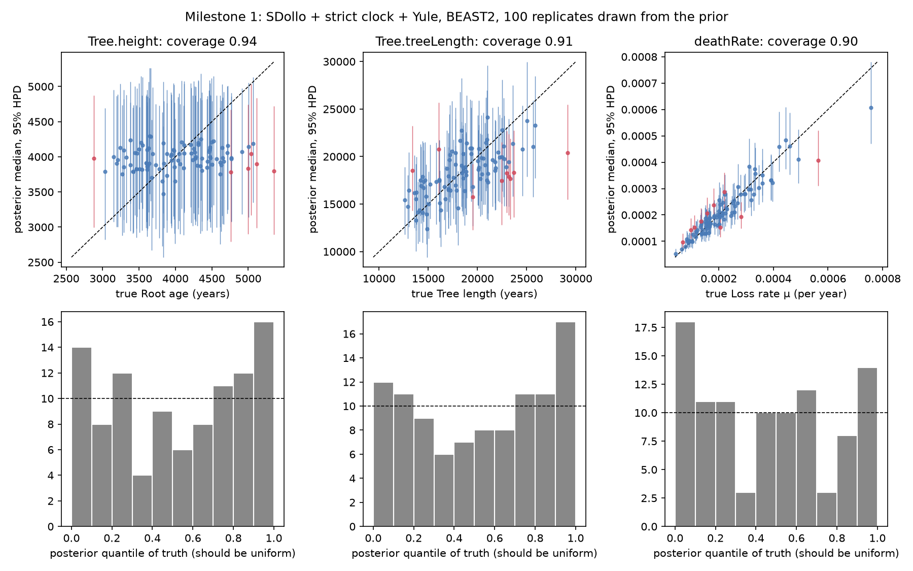
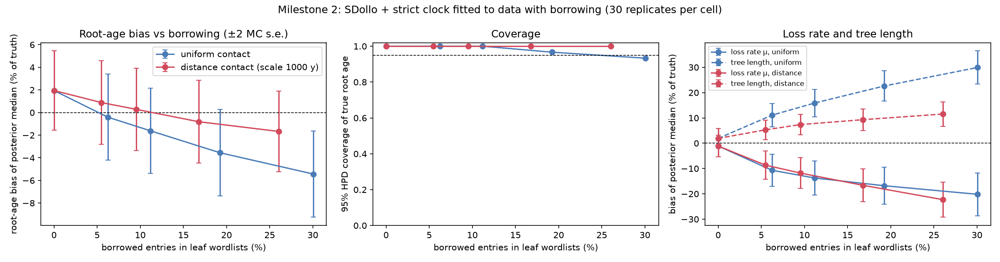
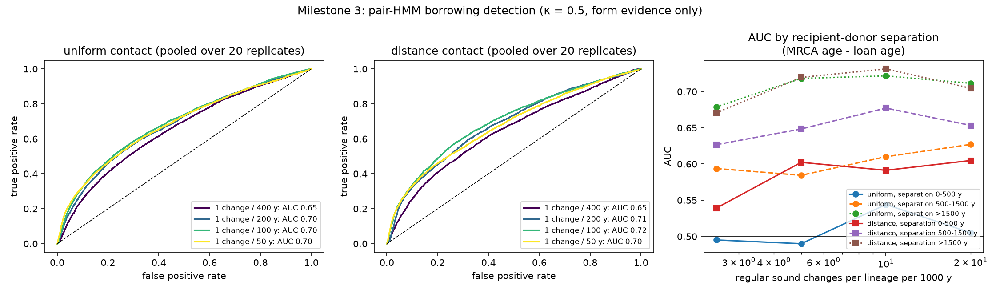

# Borrowing-aware Bayesian dating of language families

Quantifying and correcting the effect of lexical borrowing on Bayesian
divergence-time estimates, with a simulation benchmark and a Mayan case study.
The full project design is kept privately.

## Status

| Milestone | State |
|---|---|
| 0. Environment, CLDF pipeline, Mayan data, BEAST2 | done |
| 1. Simulator (no borrowing) + BEAST2 calibration | **strict clock: done** (100 replicates, below). Relaxed clock: `babelfix` written and passes the likelihood debug check; coverage study not yet run (`make m1-relaxed`) |
| 2. Bias curve vs borrowing rate, two contact models | **done** (below) |
| 3. Phoneme strings + pair HMM, ROC | **done** (below) |
| 4. Latent-donor correction | masking pipeline done; oracle vs detector refits queued. Latent-donor (level 2) model written but **does not beat level 1 yet** (below) |
| 5. Mayan application | data built (ASJP core vocabulary, 31 languages, LexStat cognates). Draft calibrations in `infer/beast/m5_mayan_prior.json` **awaiting review**; 5 BEAST2 variants queued (`scripts/m5_mayan.py`) |

## Results so far

### Milestone 1: strict clock is well calibrated

`make m1-strict`: 100 replicates with trees, root ages and loss rates drawn
from `infer/beast/m1_strict_prior.json` (10 languages, 200 concepts), each
fitted with the same prior in BEAST2.

| Parameter | 95% HPD coverage (±2 s.e.) | min ESS | rank-uniformity KS p |
|---|---|---|---|
| root age | 0.94 ± 0.05 | 1313 | 0.19 |
| tree length | 0.91 ± 0.06 | 1311 | 0.20 |
| loss rate μ | 0.90 ± 0.06 | 1362 | 0.16 (χ² p = 0.03, not significant after correcting for 3 tests) |

BEAST2's `-sampleFromPrior` marginals match the simulator's (KS p 0.25–0.65).
Note that the root-age HPD is 94% as wide as its N(4000, 500) calibration
prior: with the rate unknown, the data constrain relative ages, loss rate and
tree length much more than the absolute root. The milestone 2 summary
therefore also reports bias in μ and tree length.



### Milestone 2: bias from unmodelled borrowing

`make m2`: 30 replicates per cell, with truth drawn from the milestone 1
strict prior. Data are simulated with replacement borrowing at rate κ·μ
(κ = 0.25–2) under uniform or distance-weighted contact (e-folding at 1000 y
of patristic distance). Every fit uses the no-borrowing SDollo model.
Replicate *i* shares its tree and parameters across cells, so the **paired
Δ** (shift against the same replicate's κ = 0 fit) is the precise measure.

| Contact | Borrowed entries | Root age, paired Δ (± s.e.) | Root 95% HPD coverage | Loss rate μ bias | Tree length bias |
|---|---|---|---|---|---|
| — | 0% | 0 | 1.00 | −1% | +2% |
| uniform | 6% | −2.4% ± 0.5 | 1.00 | −11% | +11% |
| uniform | 11% | −3.6% ± 0.6 | 1.00 | −14% | +16% |
| uniform | 19% | −5.5% ± 0.7 | 0.97 | −17% | +23% |
| uniform | 30% | −7.4% ± 0.8 | 0.93 | −20% | +30% |
| distance | 6% | −1.1% ± 0.4 | 1.00 | −9% | +5% |
| distance | 10% | −1.7% ± 0.4 | 1.00 | −12% | +7% |
| distance | 17% | −2.8% ± 0.4 | 1.00 | −17% | +9% |
| distance | 26% | −3.6% ± 0.5 | 1.00 | −22% | +12% |

* **Direction.** Unmodelled borrowing makes the root *younger* and the loss
  rate *lower*, and both effects grow steadily with the borrowing rate.
  Tree length goes *up* while the root goes down, so internal nodes move
  towards the root: the tree looks more star-like.
* **Contact model.** Borrowing between near neighbours does about half the
  damage to the root and tree length. The prediction that close and distant
  borrowing bias dates in *opposite* directions is not borne out at these
  settings: both push the same way.
* **Size.** The root-age bias is small here because the root has a tight
  calibration prior (N(4000, 500); milestone 1 showed the data barely narrow
  it). The distortion shows up instead in μ (up to −22%) and tree length (up
  to +30%). **Next experiment:** calibrate internal nodes and leave the root
  vague, as in real analyses (milestone 5), to see how much of the μ bias
  turns into root-age bias.



### Milestone 3: form-level detection (pair HMM)

`scripts/m3_roc.py`, 20 replicates per setting, about 10% of entries borrowed
(κ = 0.5). The detector sees only leaf forms and cognate sets. Each language
pair gets a pair-HMM mixture of "regular correspondences" (learned) vs "loan"
(near-identity). Pair log-likelihood ratios are robustly z-scored within each
language pair, which raised pair-level AUC from 0.63 to 0.74 by removing the
pair's overall divergence. An entry's score is the mean over its cognate-set
partners.

* AUC 0.70–0.72 once regular sound change is at least 1 per 200 y per
  lineage, and 0.65 at 1 per 400 y.
* Power depends on the **separation** between recipient and donor (MRCA age
  minus loan age): chance level below 500 y, about 0.60–0.68 at 500–1500 y,
  and about 0.72 beyond. Loans between close relatives, or made soon after a
  split, are invisible in the forms.
* **Main limitation: form evidence is symmetric.** A loan makes recipient and
  donor-clade forms look alike, and nothing in the pair says who borrowed. At
  z > 1 the detector has precision about 0.42 and recall about 0.32 (κ = 1).



### Milestone 4: level 2 (negative so far)

Two latent-donor models are in `hmm/latent.py`, both fitted by EM. Mean AUC
on 10 test datasets (κ = 1, 1 sound change / 100 y):

| Model | uniform | distance |
|---|---|---|
| level 1 (mean pair score) | **0.66** | **0.70** |
| donor = a language, per-language Dirichlet profiles (`fit_latent`) | 0.57 | 0.61 |
| donor = a lineage (clade of a UPGMA tree from cognate sharing; `fit_latent_lineage`) | 0.63 | 0.68 |
| lineage + sister-clade "direction" cue | 0.54 | 0.62 |

Treating the donor as a lineage removes most of the loss from the
single-language version, since a loan from an ancestral lineage makes the
whole donor clade look alike. It still does not beat the simple mean.

The direction cue rested on a wrong assumption. The idea was that a
recipient's close relatives should lack a borrowed set. In simulation they
lack it as often as for inherited sets (uniform: 0.35 vs 0.37), or *less*
often (distance contact: 0.14 vs 0.30). Most loans happen on ancestral
branches, so the sister clade inherits the loan too, or the sister clade is
the donor. Form-level evidence therefore remains the binding constraint, and
the correction below uses level 1.

The correction study (`scripts/m4_correction.py`) refits the κ = 1 milestone 2
replicates after masking (language, concept) cells as missing, using either
the true loans (oracle: an upper bound on what any detector can gain) or the
level-1 detector.

## Quick start

```bash
make env      # Python venv from env/requirements.lock.txt
make data     # fetch raw CLDF datasets at pinned commits into data/raw/
make matrices # Mayan cognate matrix -> data/derived/kaufmanpmed/
make sim      # example simulated dataset -> data/derived/sim/example/
make test     # pytest
make beast    # install BEAST2 + pinned packages into env/ (project-local)
make beast-smoke  # short SDollo run to check BEAST2 works (~4 min)
```

`make` with no target runs env, data, matrices, sim and test.

Simulate a custom dataset:

```bash
.venv/bin/python scripts/simulate.py --out data/derived/sim/run1 --seed 7 \
    --n-tips 12 --root-age 4000 --n-concepts 200 --birth 2e-4 --loss 2e-4 \
    --gamma-shape 0.5 --clock-sd 0.3
```

Each simulated dataset directory contains a valid CLDF Wordlist
(`Wordlist-metadata.json`, `forms.csv`, `cognates.csv`, …), `tree.nwk` (the true
tree) and `truth.json` (seed, parameters, node ages, per-branch clock rates,
per-concept rates).

## Model (as simulated)

Per concept *c* and branch *b*, cognate classes are born at rate
λ·r<sub>c</sub>·ρ<sub>b</sub> and each is lost at rate μ·r<sub>c</sub>·ρ<sub>b</sub>;
a class is born once and never re-born (Dollo). Here r<sub>c</sub> ~ Gamma(α, 1/α)
(optionally discretised into *k* categories, Yang 1994 mean method) and
ρ<sub>b</sub> ~ LogNormal(−σ²/2, σ²) (mean 1). The root is at stationarity:
Poisson(λ/μ) classes per concept. Simulation is exact in continuous time.

A language with no class for a concept is coded missing (`?`) for every class
of that concept, because absence is then a lexical gap rather than evidence.

### Validation

`tests/test_sdollo.py` checks the simulator against closed-form expectations on a
two-taxon tree of age *T*: the expected number of shared classes is
C·(λ/μ)·E[exp(−μT·r<sub>c</sub>(ρ<sub>1</sub>+ρ<sub>2</sub>))], tested under a strict
clock, unequal λ≠μ, discrete gamma, continuous gamma and a relaxed clock (the
lognormal Laplace transform is integrated numerically). Stationarity is checked
on a Yule tree. Structural tests check the Dollo property (every class sits only
in descendants of its birth branch), missing-data coding and seed
reproducibility. As a power check, a 5% error in the loss rate moves the
shared-class statistic by about 15 standard errors.

## BEAST2

`env/install_beast2.sh` installs the BEAST 2.7.7 macOS/Linux bundle (launcher +
JRE; no system Java needed) into `env/beast2/`, and the CBAN packages into
`env/beast2-packages/`. These versions are pinned exactly: BEAST.base 2.7.8, BEAST.app 2.7.8,
BEASTLabs 2.0.3, Babel 0.4.2. Babel requires BEAST.base 2.7.8, so the effective
core is 2.7.8 running on the 2.7.7 launcher. Always pass
`-packagedir env/beast2-packages` (the Makefile does).

Timing note: the shortened SDollo example (24 taxa, 2×10⁵ states) takes about 225 s
on an Apple-silicon laptop. That is the cost that motivates Track B.

## Data

| Dataset | Source | Pinned commit | Notes |
|---|---|---|---|
| `kaufmanpmed` | [lexibank/kaufmanpmed](https://github.com/lexibank/kaufmanpmed) — Kaufman & Justeson (2003) *A Preliminary Mayan Etymological Dictionary*, CC-BY-4.0 | `a774237` | 104 non-proto varieties × 3,030 cognate sets |

**Caveat on the Mayan data.** Lexibank has no Swadesh-style Mayan wordlist with
expert cognate coding; `kaufmanpmed` is the only Mayan cognate dataset there.
It is an *etymological dictionary*: its "concepts" are 5,932 language-specific
glosses (often Spanish), not a shared comparative concept list, so a missing
cognate set means "not recorded", not "lost". It is built here with
`--no-concept-missing` (absence = 0) only to exercise the pipeline. It is not
suitable for dating as it stands. Before milestone 5 we need to either
(a) map a basic-vocabulary subset onto Concepticon and treat absence there as
informative, or (b) find a dedicated Mayan basic-vocabulary dataset (for example
from the ASJP/Wichmann line or published Mayan phylogenetic studies). 

**Milestone 5 data: ASJP + automated cognates** (`make matrices`,
`pipeline/asjp.py`). From `lexibank/asjp` v21.1 (pinned): the 109 Mayan
doculects reduce to 31 languages (one per Glottolog languoid, ≥ 28 of the 40
core concepts). Every major branch is present: Huastecan, Yucatecan,
Cholan–Tzeltalan, Q'anjobalan, Mamean, K'iche'an, Mocho' and Chicomuceltec.
The 15 forms ASJP flags as loans (Spanish) are removed. Cognates come from
LingPy LexStat at threshold 0.75: 255 sets, 2.5% missing cells.

* **Threshold calibration.** On simulated wordlists of the same shape
  (31 × 40, root ≈ 4000 y), B-cubed F was 0.73 / 0.84 / 0.90 / **0.93** at
  thresholds 0.45 / 0.55 / 0.65 / **0.75** (P 0.93, R 0.93 at 0.75). At
  LingPy's usual 0.55, obvious Mayan cognates were split; for example,
  reflexes of *\*ka'ib'* "two" fell into 4 sets. At 0.75 they form one.
* **Known errors at 0.75**, from spot checks: *k'ak'al* (from "fire") is
  merged into "sun"; *siwan* is merged with *tun* "stone"; *tunich* is split
  from *tun*. Cognate-coding noise of this size should be propagated (e.g.
  re-run at 0.65/0.75/0.85) and simulated before dates are interpreted.
* **Level-1 detector on real data.** The highest-scoring entries are short,
  pan-Mayan retentions (*uk'* "louse", *im* "breast", *ha'* "water"), not
  loans. Identical forms in distant languages look loan-like to the model.
  The simulator has no segment-specific stability, so it never produced this
  failure. Follow-up tests (8 simulated replicates each, κ = 0.5):

  | Simulated phonology | AUC |
  |---|---|
  | default (2–3 syllable roots) | 0.80 |
  | + stable segments (`stable_segments`, weight 0.05) | 0.74 |
  | Mayan-like CVC roots | 0.72 |
  | CVC + stable segments | **0.67** |

  So the milestone 3 AUCs are optimistic for a family like Mayan.
  Concept-wise normalisation (subtracting each concept's median score)
  *lowered* AUC (0.80 → 0.65), and normalising pair LLRs by word length had no
  effect; both were dropped. Separating shared retentions from loans will
  probably need more than form similarity, such as a model of segment-specific
  stability.

**Milestone 5 calibrations (draft, to be reviewed before any date is
reported)** are in `infer/beast/m5_mayan_prior.json`. Every point carries
its source and status. Glottochronological dates, including Kaufman's
c. 2200 BC for Proto-Mayan, are deliberately excluded: using them as
calibrations would make the test circular.

| Node | Prior (years before AD 2000) | Basis |
|---|---|---|
| root (Proto-Mayan) | Uniform(1500, 9000) | spans all published estimates (c. 6600 BC to c. 209 BC) |
| Yucatecan crown (monophyletic) | Normal(1050, 200) | Proto-Yucatecan c. AD 950 (Hofling 2018) |
| Huastecan crown (monophyletic) | Uniform(480, 1100) | Chicomuceltec–Huastec split Postclassic (Kaufman 1980; Kaufman & Justeson 2008; Robertson & Houston 2015) |
| *sensitivity only:* Cholan crown | Uniform(1750, 4000) | Classic Ch'olti'an in inscriptions from c. AD 250 (Houston, Robertson & Stuart 2000). **Contested**: Mora-Marín argues Cholan diversification is Postclassic |

The loss-rate prior, LogNormal(−9, 1) with mean about 2e-4 per year, also
carries absolute-time information and needs the same review. Variants:
strict and relaxed clocks; + Cholan calibration; cognate thresholds 0.65 and
0.85.

**Kaufmanpmed checked and rejected for dating.** `kaufmanpmed` cannot be made into a
basic-vocabulary dataset. None of its 5,932 glosses is linked to Concepticon,
and its `Loan` column is empty. Matching the Swadesh-100 concepts to etymon
glosses finds 22 concepts, only 14 of which are attested in at least 20 of
the 104 modern varieties. Searches of the Lexibank and CLDF-datasets
organisations and the literature found no cognate-coded Mayan Swadesh
dataset. The realistic options:

1. **ASJP** (`lexibank/asjp`, 40-item basic lists for nearly every Mayan
   variety) with **automated cognate detection** (LexStat), as in
   Rama & Wichmann. Fully reproducible. Cognate errors become an extra noise
   source, which the simulator could model.
2. Request the cognate-coded Swadesh data behind published Mayan
   phylogenies (e.g. Atkinson 2006) from the authors.
3. Expert cognate coding, which is out of scope.

Raw data under `data/raw/` is fetched by `scripts/fetch_data.sh`, made
read-only, and never edited. Everything under `data/derived/` is regenerated
by `make`.

## Layout

```
env/          pinned Python lockfile; BEAST2 installer
infer/        BEAST2 XML generation, runner, loan masking; beast/ = templates, prior specs, babelfix
data/raw/     fetched CLDF datasets (git-ignored, pinned commits)
data/derived/ cognate matrices, simulated datasets (git-ignored, rebuilt by make)
sim/          forward simulator: tree.py, sdollo.py, borrowing.py, phonology.py
pipeline/     CLDF I/O shared by real and simulated data
scripts/      CLI entry points used by the Makefile
infer/cpp/    Track B (later)
hmm/          pair HMM (level 1) and latent-donor mixture (level 2)
analysis/     bias curves, ROC, figures
tests/
figures/
```
